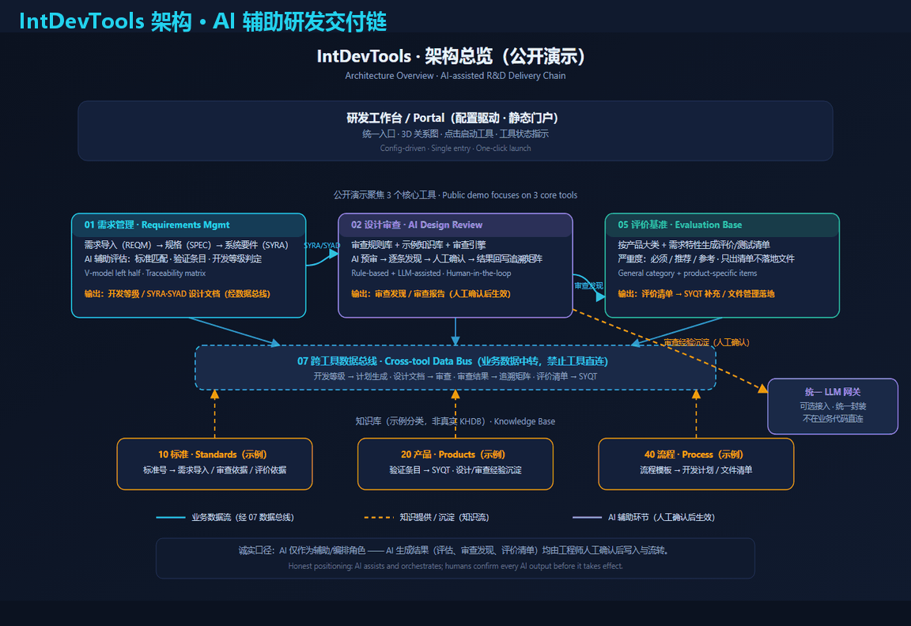
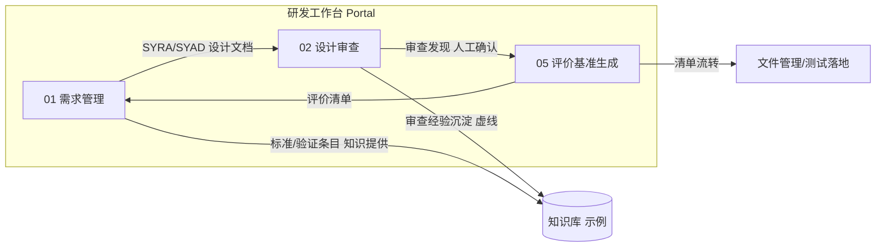

# IntDevTools Public Demo · AI 加速工业/嵌入式研发交付

> **AI-assisted R&D delivery chain** for industrial / embedded product development.
> 需求导入 → AI 设计审查 → AI 生成评价基准 → 知识沉淀，一条链路跑通。

<div align="center">

[](https://quentinqj.github.io/IntDevTools-Public-Demo/)
[](LICENSE)

**公开演示 · Public Demo · 公開デモ** — 所有数据均为虚构示例，不包含任何真实公司/产品/内部知识库信息。

</div>

---

## 30 秒讲清 · 30-second Pitch

> 我搭建了一条**AI 辅助的研发交付链**：需求一进来，AI 帮你对照标准、判定开发等级；设计稿出来，AI 先预审一遍、列出风险点，工程师逐条确认；确认后的发现自动变成评价/测试清单，再沉淀回知识库，下个项目直接复用。
>
> 定位是 **AI 编排 / 辅助**，不是"AI 全自动"——每个 AI 结果都必须人工确认后才生效。

**Core chain:** Requirements intake → AI design review → AI-generated evaluation base → knowledge loop-back.

---

## 🚀 Live Demo（能打开的优先）

- **线上（推荐）**: <https://quentinqj.github.io/IntDevTools-Public-Demo/>
- **本地（零依赖）**: 克隆本仓库后直接双击 `demo/index.html`（纯静态 HTML/CSS/JS，无需安装、无需联网、无后端）。

演示以虚构项目「某传感器控制器开发（SC-2026-001）」走完 4 步：

| 步骤 | 内容 | AI 用在哪 |
|---|---|---|
| ① 需求导入 | 需求清单 + 能力评估 | AI 对照示例标准、建议验证条目、判定开发等级 L2（人工确认） |
| ② 设计审查 | 设计文档（SYRA 摘要） | AI 依据审查规则预审，输出 3 项发现（高/中/低），逐条人工确认 |
| ③ 评价基准 | 14 项评价/测试清单 | AI 按产品大类生成（必须/推荐/参考），确认后流转 |
| ④ 知识沉淀 | 新知识条目 KB-2026-031 | 审查经验提炼回示例知识库，新项目可复用 |



---

## 🏗️ 架构（公开演示版）

本演示对应真实系统 IntDevTools（11 个 Flask 服务研发工作台）中 **3 个核心工具** + 数据总线 + 知识库，做轻量化呈现：

```
┌────────────────────────────────────────────────────────────────────┐
│                    研发工作台 / Portal（配置驱动 · 静态门户）            │
├───────────────┬────────────────────────┬───────────────────────────┤
│ 01 需求管理   │  02 设计审查 (AI)       │  05 评价基准生成 (AI)        │
│ REQM→SYRA     │  规则库+知识库+引擎     │  按产品大类生成清单           │
│ 开发等级判定   │  预审→人工确认→回写     │  必须/推荐/参考 · 只出清单    │
└───────┬───────┴──────────┬─────────────┴─────────────┬─────────────┘
        │  业务数据经 07 数据总线中转（工具间禁止直连）          │
        ▼                  ▼                           ▼
┌────────────────────────────────────────────────────────────────────┐
│          知识库（示例分类）· 10 标准 / 20 产品 / 40 流程             │
│          知识提供（实线）→ 工具；工具沉淀经验（虚线）← 知识库          │
└────────────────────────────────────────────────────────────────────┘
```

- 完整架构图（SVG/PNG）：[docs/architecture.svg](docs/architecture.svg) · [docs/architecture.png](docs/architecture.png)
- 架构说明：[docs/architecture.md](docs/architecture.md)
- 一页案例（中/日）：[docs/case-study.md](docs/case-study.md) · [可打印网页版](docs/case-study.html)



---

## 📁 仓库结构

```
IntDevTools-Public-Demo/
├── README.md                 # 本文件（中文 + 日文）
├── LICENSE                   # MIT License
├── demo/                     # 公开演示（纯静态，双击即开 / GitHub Pages）
│   ├── index.html            # 入口
│   ├── css/style.css
│   └── js/
│       ├── data.js           # 虚构样例数据
│       └── app.js            # 步骤状态机 + AI 模拟
├── demo-data/                # 样例数据（可读文件版）
│   ├── kb/                   # 示例知识库（10 标准 / 20 产品 / 40 流程）
│   └── project_sc2026/       # 虚构项目样例（REQM / SYRA / 审查报告 / 评价清单）
├── docs/
│   ├── architecture.md       # 架构说明
│   ├── architecture.svg|png  # 架构图
│   ├── case-study.md         # 一页案例（中/日双语）
│   └── case-study.html       # 一页案例 · 可打印网页版
├── screenshots/              # 截图 + GIF（demo-chain.gif）
└── scripts/                  # 截图/GIF 复现脚本（本地开发用）
```

---

## ⚡ 快速开始（≤ 10 分钟）

**方式 A：打开线上演示（0 分钟）**
1. 访问 <https://quentinqj.github.io/IntDevTools-Public-Demo/>
2. 按左侧 ①→④ 顺序点击，体验整条链路；AI 结果需点「确认」才生效。

**方式 B：本地打开（0 分钟，零依赖）**
1. `git clone https://github.com/quentinqj/IntDevTools-Public-Demo.git`
2. 双击 `demo/index.html`（或 `python -m http.server 8000` 后访问 `http://127.0.0.1:8000/demo/`）。

**方式 C：复现截图 / GIF（需要 Windows + Edge）**
1. 安装 Python 3.10+：`pip install pillow`
2. `powershell -File scripts/capture_screenshots.ps1`（用无头 Edge 导出 4 步截图）
3. `python scripts/make_gif.py`（合成 `screenshots/demo-chain.gif`）

> 演示为**确定性模拟**（规则 + 示例知识库），离线可用；真实系统通过统一 LLM 网关调用，此处不依赖任何外部 API。

---

## 🧭 对应到简历的「AI 实践」

- **AI 编排 / 辅助**：需求评估、设计预审、评价基准生成三个环节的 AI 结果均由人工确认后生效（human-in-the-loop）。
- **知识闭环**：审查经验 → 知识库沉淀 → 新项目复用，形成可积累的研发资产。
- **工程落地**：跨工具数据总线、工具间禁止直连、配置驱动、测试驱动（`tests/run_tests.py`）。

---

## ⚠️ 数据红线声明

- 本仓库所有项目、需求、设计、评价、知识库内容均为**虚构示例**。
- 不含任何真实公司名称、产品型号、内部数据、密钥或账号。
- 示例标准编号（如 IEC 60947-5-2）仅为通用工业标准引用，请以目标市场现行标准为准。

---

## 📄 License

[MIT](LICENSE)

---

## 日本語（Japanese）

# IntDevTools 公開デモ · AI による産業/組込み系開発のデリバリ高速化

> 産業機器・組込み開発向けの **AI 支援型 R&D デリバリチェーン** の公開デモです。

## 30秒で伝える内容

> 要件が入ったら AI が標準との照合・開発レベルの判定を支援。設計書が上がってきたら AI が事前レビューし、リスク項目を列挙、エンジニアが一つずつ確認。確認済みの指摘は評価・テスト項目に変換され、ナレッジベースに蓄積、次のプロジェクトで再利用できます。
>
> 位置づけは **AI によるオーケストレーション／アシスト**であり、**「AI 全自動」ではありません**——AI の出力は必ず人間の確認を経て反映されます。

**コアチェーン：** 要件取込み → AI 設計レビュー → AI 評価基準生成 → ナレッジ蓄積（ループバック）

## ライブデモ

- オンライン：<https://quentinqj.github.io/IntDevTools-Public-Demo/>
- ローカル（依存なし）：`demo/index.html` をダブルクリック（静的 HTML のみ、インストール不要・オフライン可）

架空プロジェクト「某センサーコントローラ開発（SC-2026-001）」で 4 ステップを体験：

| ステップ | 内容 | AI の役割 |
|---|---|---|
| ① 要件取込み | 要件一覧 + 能力評価 | 標準照合・検証項目提案・開発レベル L2 判定（要確認） |
| ② 設計レビュー | 設計ドキュメント（SYRA 要約） | レビュールールに基づき事前レビュー、指摘 3 件（高/中/低）を提示 |
| ③ 評価基準 | 評価・テスト項目 14 件 | 製品カテゴリから生成（必須/推奨/参考）、確認後に連携 |
| ④ ナレッジ蓄積 | 新規ナレッジ KB-2026-031 | レビュー経験をナレッジベースに蓄積し再利用 |

## アーキテクチャ（公開デモ版）

実際の IntDevTools（11 の Flask サービスの研究開発ワークベンチ）から **3 つのコアツール**（要件管理・設計レビュー・評価基準生成）+ データバス + ナレッジベースを軽量に再現しています。

- アーキテクチャ図：[docs/architecture.png](docs/architecture.png) / [docs/architecture.svg](docs/architecture.svg)
- ワンページ事例（中/日）：[docs/case-study.md](docs/case-study.md)

## クイックスタート（10 分以内）

1. オンライン：上記 Live Demo を開く（0 分）
2. ローカル：`git clone` 後、`demo/index.html` をダブルクリック（0 分・依存なし）
3. スクリーンショット再現（任意）：`pip install pillow` → `scripts/capture_screenshots.ps1` → `scripts/make_gif.py`

## データに関する注意

- 本リポジトリのプロジェクト・要件・設計・評価・ナレッジベースは**すべて架空のサンプルデータ**です。
- 実在の企業名・製品型番・内部データ・鍵・アカウント情報は一切含みません。

## ライセンス

[MIT](LICENSE)

---

*Made with the IntDevTools approach: config-driven, AI-assisted, human-confirmed.*
